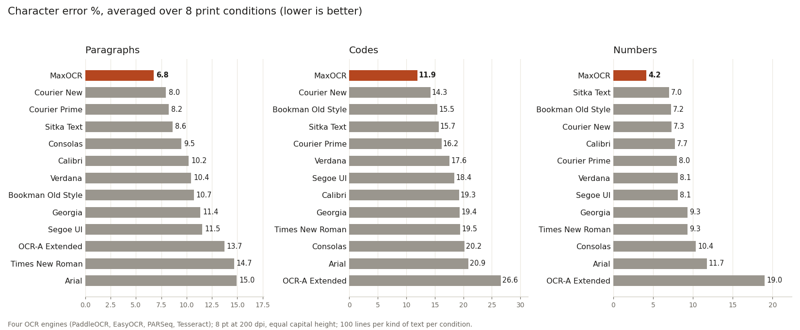
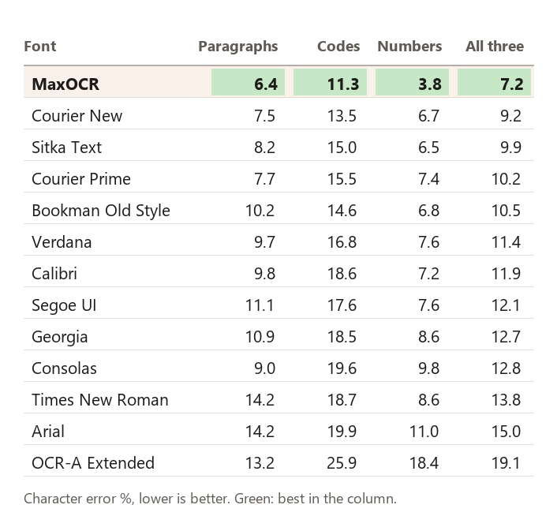
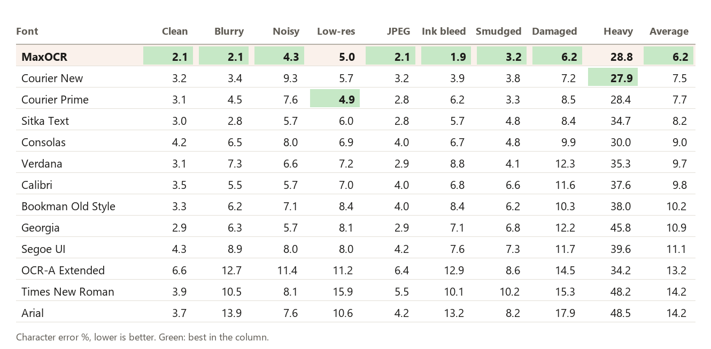
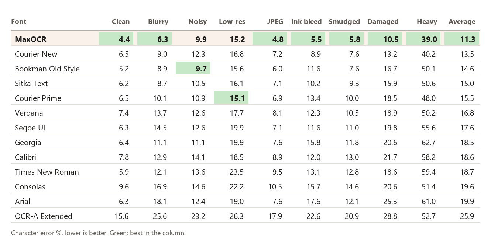
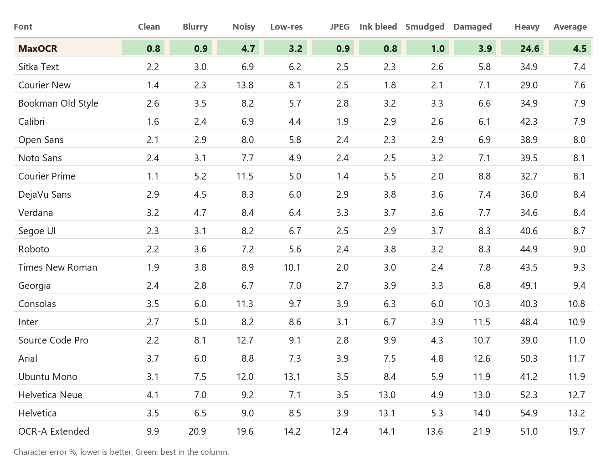

# MaxOCR

A font for text that people read and machines read back: receipts, labels, invoices, forms, serial numbers, anything
that will be scanned, photographed or faxed and then run through OCR. It looks like an ordinary serif book face,
but every character is shaped and spaced so that OCR engines confuse it with as few other characters as possible.

**Version 0.96.** 95 characters: A–Z, a–z, 0–9, space and all 32 ASCII punctuation marks.

## Which file to use

| File | Use it for |
|---|---|
| `MaxOCR.ttf` | **Start here.** Everyday text, codes and numbers. Adds a little space where letters meet digits (applied automatically in apps that support kerning). |
| `MaxOCR-Text.ttf` | The same letters with plain spacing everywhere (no extra space between letters and digits). |
| `MaxOCR-Small.ttf` | Print smaller than about 7 pt (wider letter spacing; cuts errors by about 12% at 6 pt). |
| `MaxOCR-Machine.ttf` | Machine-only work where looks do not matter: capitals, digits and space only. |

## How it compares

Character error rate (the share of characters an OCR engine gets wrong), averaged over nine print conditions from
crisp to badly damaged. Lower is better.

Across all three kinds of text, MaxOCR makes **22% fewer errors than the next best font** (Courier New) and **about
half as many as Arial or Times New Roman**. The gap is largest on **numbers**: 3.8% against 6.5% for the next best
font.

The comparison set is the fonts people use most (Arial, Times New Roman, Calibri, Segoe UI, Verdana, Georgia,
Consolas, Courier New), the leaders of a 413-font survey we ran at the start of the project (Bookman Old Style,
Sitka Text), the classic OCR font (OCR-A Extended), and Courier Prime, the open-licence font with the most readable
punctuation of the 450 we tested.

### By kind of text and kind of damage

The three kinds of text:

- **Paragraphs**: lines of a short story set in a grocery store, with prices, receipt codes and all 32 punctuation marks.
- **Codes**: random mixed-case letters and digits, 6–12 characters long, like order numbers, serials and passwords.
- **Numbers**: digits only, in groups separated by spaces, like barcodes, card numbers and phone numbers.

The nine print conditions:

| Condition | What it simulates |
|---|---|
| Clean | Crisp print, scanned perfectly |
| Blurry | An out-of-focus scan or phone photo |
| Noisy | A speckled, grainy scan |
| Low-res | A fax, or an image shrunk to half size and blown back up |
| JPEG | Heavy compression (quality 15) |
| Ink bleed | Ink spreading into the paper: every stroke about 1 pixel heavier |
| Smudged | A finger dragged through wet ink: the whole line smeared sideways, more in some places than others |
| Damaged | Blur, ink spread, tilt, perspective, uneven light, noise and JPEG together, mild |
| Heavy | Blur, ink spread, tilt, perspective, uneven light, noise and JPEG together, severe |

Here is each condition applied to its own name. The left column is actual size, the 8 pt text as scanned at 200 dpi,
exactly what the engines receive. The right column is the same damage enlarged 3× so you can see it. Both are
shown in grey; the engines get them after a final black-and-white step, as in most OCR pipelines.

In the tables below, the best value in each column has a green background. The same numbers are in
[docs/benchmark_results.csv](docs/benchmark_results.csv).

**Paragraphs**

**Codes**

**Numbers**

What the tables show, compared with the best other font in each condition. With 100 lines per cell, differences
under about one point are within the test's noise (see "How it was measured").

| Text | MaxOCR clearly ahead (by more than 1 point) | MaxOCR slightly ahead (under 1 point) | Another font ahead |
|---|---|---|---|
| Paragraphs | noisy, ink bleed | clean, blurry, JPEG, damaged | low-res and smudged (Courier Prime, by 0.1 and 0.4), heavy (Courier New, by 2.0) |
| Codes | blurry, JPEG, ink bleed, smudged, damaged, heavy | clean | noisy (Bookman Old Style, by 0.3), low-res (Courier Prime, by 0.1) |
| Numbers | noisy, low-res, smudged, damaged, heavy | clean, blurry, JPEG, ink bleed | none |

- MaxOCR's clearest advantage is on damaged print, especially for codes and numbers, which have no surrounding
  words to help an engine guess.
- On clean print every good font does well, and MaxOCR's lead is small.
- Courier New's 2-point lead on heavily damaged paragraphs is the only place another font is clearly better.
- **OCR-A Extended**, the font designed for 1960s optical readers, does worst overall with today's engines.

## Letters that run together

OCR engines often read two narrow letters as one wide one. Each pair was printed inside codes, blurred and read by
the same four engines. These numbers come from version 0.91; none of the letters involved has changed since.

| Pair read as one letter | MaxOCR |
|---|---:|
| vv as w | 0.0% |
| VV as W | 0.5% |
| rn as m | 1.0% |
| cl as d | 0.0% |
| ri as n | 0.0% |
| in as m | 0.0% |

None of the single letters was ever read as the pair.

## AI readers

A vision-language model (Qwen2.5-VL) reads clean text in almost any font nearly perfectly. In our measurements on clean
text and codes, MaxOCR's character error was 0.33% and Courier New's 0.24%. The difference is a handful of characters, within
the test's noise. MaxOCR's advantage is with conventional OCR engines and damaged print.

## How it was measured

- **Engines.** PaddleOCR, EasyOCR, PARSeq and Tesseract (with its dictionaries on). Every number above is the
  average of the four.
- **Reading mode.** All engines read case-sensitively over letters, digits and punctuation.
- **Scoring.** Character error from an alignment of the engine's output with the true text, ignoring spaces.
- **Printing.** 8 pt at 200 dpi. Every font is set at the same capital height, so fonts with large letters get no
  advantage. Every image is converted to black and white (Otsu), as most OCR pipelines do.
- **Sample size.** 100 lines per kind of text per condition, the same lines for every font. With 100 lines,
  differences under about one point are within noise.
- **Simulated damage.** All damage is simulated. A print-and-scan test on paper is still to come.
- **Reproducing.** Install the project environment with `pixi install` (under WSL on Windows; the comparison fonts
  are read from `C:\Windows\Fonts`). Then run `pixi run python scripts/readme_bench.py`; results go to
  `out/report/readme_bench.csv`.

## How it was made

1. **Survey.** We measured 413 installed fonts to learn which characters OCR engines confuse and which shapes
   keep them apart. For example, the engines ignore slashes and dots inside zeros; what helps most is a wide O next
   to a narrow, tall 0.
2. **Building the letters.** Each character was built from open-licence fonts, then tuned against the four
   engines one confusion at a time: 0/O, 1/l/I, 5/S, 2/Z, 8/B, rn/m and vv/w.
3. **Cleanup.** Every outline was redrawn by hand to remove the lumps and notches the blending left behind.
4. **Final letters.** C, O, g, t and J were chosen from 58 open-licence serif faces for the most normal look that
   still scored well.

`DECISIONS.md` records every step, measurement and choice.

## License

MaxOCR is built only from fonts under the SIL Open Font License 1.1. It will be released under the same license with
version 1.0, together with the license file and full credits for the source fonts. The fonts in the comparison were
measured, never copied.
