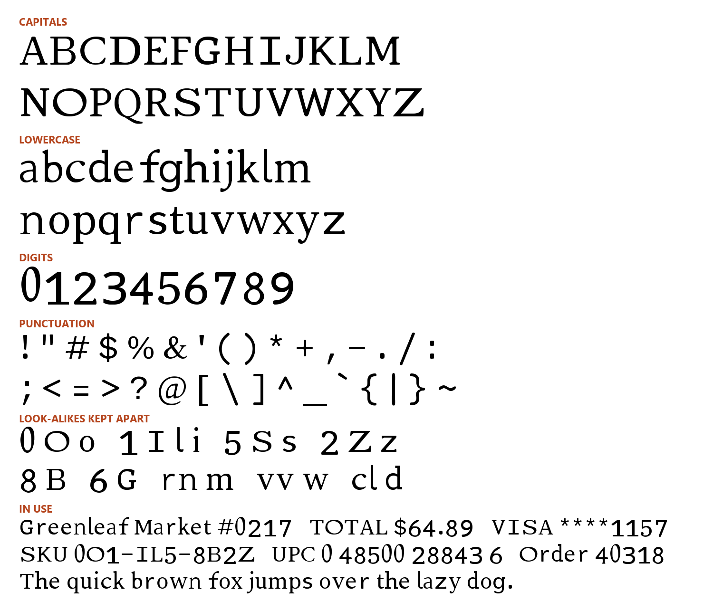
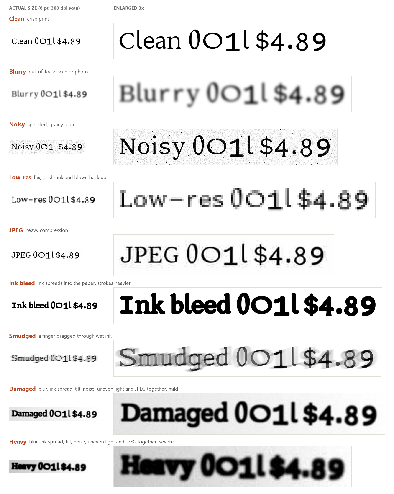

# MaxOCR

A font for text that people read and machines read back: receipts, labels, invoices, forms, serial numbers, anything
that will be scanned, photographed or faxed and then run through OCR. It looks like an ordinary serif book face,
but every character is shaped and spaced so that OCR engines confuse it with as few other characters as possible.



**Version 0.98.** 95 characters: A–Z, a–z, 0–9, space and all 32 ASCII punctuation marks.

## Which file to use

| File | Use it for |
|---|---|
| `MaxOCR.ttf` | **Start here.** Everyday text, codes and numbers. Adds a little space where letters meet digits (applied automatically in apps that support kerning). |
| `MaxOCR-Text.ttf` | The same letters with plain spacing everywhere (no extra space between letters and digits). |
| `MaxOCR-Small.ttf` | Print smaller than about 7 pt (wider letter spacing; cuts errors by about 12% at 6 pt). |
| `MaxOCR-Machine.ttf` | Machine-only work where looks do not matter: capitals, digits and space only. |

## How it compares

Character error rate (the share of characters an OCR engine gets wrong), averaged over nine print conditions from
crisp to badly damaged. Lower is better.


Across all three kinds of text, MaxOCR makes **22% fewer errors than the next best font** (Courier New) and **about
half as many as Arial, Times New Roman or Helvetica**. The gap is largest on **numbers**: 4.5% against 7.4% for the
next best font.

The comparison set:

- **Windows:** Arial, Times New Roman, Calibri, Segoe UI, Verdana, Georgia, Consolas, Courier New. Arial, Times New
  Roman, Georgia, Verdana and Courier New also come with every Mac.
- **Apple:** Helvetica and Helvetica Neue. Apple's San Francisco and New York are not included: their licence allows
  them only for designing apps for Apple devices.
- **Phones, Linux and the web:** Roboto, Open Sans, Noto Sans, DejaVu Sans, Inter, Ubuntu Mono, Source Code Pro.
- **The best we found:** the leaders of a 413-font survey we ran at the start of the project (Bookman Old Style,
  Sitka Text), the classic OCR font (OCR-A Extended), and Courier Prime, the open-licence font with the most readable
  punctuation of the 450 we tested.

### By kind of text and kind of damage

The three kinds of text:

- **Paragraphs**: lines of a short story set in a grocery store, with prices, receipt codes and all 32 punctuation marks.
- **Codes**: random mixed-case letters and digits, 6–12 characters long, like order numbers, serials and passwords.
- **Numbers**: digits only, in groups separated by spaces, like barcodes, card numbers and phone numbers.

<details>
<summary>The grocery story (the paragraphs test text)</summary>

Written for the test: everyday prose mixed with prices, codes, receipt lines and every ASCII punctuation mark. The
test splits it into lines of up to 22 characters (198 lines), then again into lines of up to 26 for the rest of
its 300 lines.

```text
The Saturday List

Odile Brennan reached Greenleaf Market #0217 at 8:05 AM, just as the automatic doors slid open and the smell of warm sourdough drifted out from Barnes & Daughters, the bakery by the entrance. Her list was written on the back of an old envelope: 2% milk, 1 dozen eggs, olive oil, Zesty Lime seltzer (12-pack, if the <<< 2 for $9 >>> deal was still on), clams for Sunday's chowder, and "something for Bo's birthday." She folded it twice, tucked it into her coat pocket, and pulled a cart from the corral; it wobbled to the left, as they always do.

In aisle 5 the shelf tag for the olive oil read "SKU 0O1-IL5-8B2Z, Verde Hills Extra Virgin, 500 mL, $8.49." The bottle beside it had a sticker that said $6.99, and the UPC under the barcode was 0 41196 01523 8. Odile photographed both with her phone, because last month the register had charged her the shelf price instead of the sale price, and the manager, a tall man named Clement, had refunded the $1.50 with a small, embarrassed bow.

The dairy case was half empty. She found the milk (UPC 0 70852 99310 4, best by 10/19/26) behind a row of oat-milk cartons, and the eggs (Grade A Large, SKU EGG-12L-0716) on the bottom shelf, where a handwritten card warned: "Limit 2 per customer - thank you!" A boy in a red cap was arranging yogurt cups into a tower: vanilla, lemon, mixed berry, then vanilla again. "Modern art," he told her solemnly. She agreed that it was.

At the seafood counter the clerk weighed the clams on a scale that printed a label: "Littleneck Clams, 1.25 lb @ $11.98/lb, NET $14.98, PLU 4011-C7, packed 10/10/26 07:42." She had asked for about a pound; the scale said otherwise (~1.25 lb, close enough). Odile asked whether the clams were local. "Rhode Island," the clerk said, "came in on the 6 o'clock truck." He wrapped them in brown paper, wrote "B. ODILE" on the side in grease pencil, and added a lemon at no charge.

The birthday present took longer. Bo was turning 11 and liked three things: puzzles, burnt-sugar candy, and anything with a lighthouse on it. In aisle 12 she found a 500-piece puzzle called "Lighthouse at Cape Vvhite" (the box really did spell it with two v's), SKU PZ-500-LH81, $14.99. Next to it was a tin of burnt-sugar toffee, item #8806-31B, marked down from $7.25 to $5.00. She took both, and a card with a cartoon gull that said "Have a Whale of a Day!"

The self-checkout lanes were closed for maintenance, so she joined Lane 3, where the cashier, Ilona, scanned everything with a steady beep, beep, beep. While she waited she joined the store Wi-Fi (network GLM\Guest, password Fresh`Picks_26, taped to the register). The olive oil rang up at $8.49. Odile showed the photo; Ilona called for a price check ("Price check on 3, Verde Hills, five hundred mil"), and two minutes later the screen showed "PRICE OVERRIDE -1.50 / AUTH CL2017." The seltzer, the milk, the eggs, the clams, the puzzle, the toffee, and the card came to $63.62 before tax. Her phone buzzed: {Greenleaf Rewards} +65 pts = 1,305 pts [Gold tier].

The receipt was long enough to curl. At the bottom it read: "SUBTOTAL 63.62 | TAX (2.00%) 1.27 | TOTAL $64.89 | VISA ****1157 | AUTH 8BZ2Q5 | REF 000418-227590-36 | TRANS #5513 | STORE 0217 | TERM 03 | OP 1I0L | 10/10/2026 08:51:17 | ITEMS 8 | [MEMBER] YOU SAVED $3.75 TODAY | e-receipt: odile_b@example.com." Below that, a coupon promised "$2 OFF your next purchase of $25 or more - code GLM-2Z5S-08OB - valid until 11/30/26 ^ see back for details." Someone had scribbled "5 * 3 = 15?" on the back.

Outside, the wind had picked up. Odile loaded the bags into the trunk: milk and eggs on the left, clams in the cooler, the puzzle wedged upright so its corners would not crush. She checked the list one more time, crossed off every line with a short, satisfied stroke, and found a note she had forgotten writing at the very bottom of the envelope: "Call Mom (555) 013-2287 - ask about the 1/2 cup vs 1/3 cup thing." She laughed, started the car, and drove home with the radio on.
```

</details>

The nine print conditions:

| Condition | What it simulates |
|---|---|
| Clean | Crisp print, scanned perfectly |
| Blurry | An out-of-focus scan or phone photo |
| Noisy | A speckled, grainy scan |
| Low-res | A fax, or an image shrunk to half size and blown back up |
| JPEG | Heavy compression (quality 15) |
| Ink bleed | Ink spreading into the paper: every stroke about 1 pixel heavier |
| Smudged | A finger dragged through wet ink: the whole line smeared sideways, more in some places than others |
| Damaged | Blur, ink spread, tilt, perspective, uneven light, noise and JPEG together, mild |
| Heavy | Blur, ink spread, tilt, perspective, uneven light, noise and JPEG together, severe |

Here is each condition applied to its own name. The left column is actual size, the 8 pt text as scanned at 200 dpi,
exactly what the engines receive. The right column is the same damage enlarged 3× so you can see it. Both are
shown in grey; the engines get them after a final black-and-white step, as in most OCR pipelines.



In the tables below, the best value in each column has a green background. The same numbers are in
[docs/benchmark_results.csv](docs/benchmark_results.csv).

**Paragraphs**


**Codes**


**Numbers**


What the tables show: how many fewer errors MaxOCR makes than **the best other font** in each condition. A negative
number means that font made fewer errors than MaxOCR.

| Text | Clean | Blurry | Noisy | Low-res | JPEG | Ink bleed | Smudged | Damaged | Heavy |
|---|---:|---:|---:|---:|---:|---:|---:|---:|---:|
| Paragraphs | 20% | 26% | 18% | 0% | 25% | 45% | 6% | 19% | −3% |
| Codes | 7% | 25% | 6% | 5% | 20% | 35% | 15% | 28% | 1% |
| Numbers | 32% | 61% | 29% | 27% | 36% | 53% | 52% | 33% | 15% |

- **Clean print.** MaxOCR makes 20% fewer errors than the best other font on paragraphs (Sitka Text), 7% fewer on
  codes (Bookman Old Style) and 32% fewer on numbers (Courier Prime). Against the everyday fonts it's 35–68% fewer
  than the average of Arial, Times New Roman and Calibri.
- **Numbers.** MaxOCR leads in all nine conditions, with 15–61% fewer errors than the best other font.
- **Damage.** The largest leads are under ink bleed (35–53%) and on blurry and smudged numbers (61% and 52%).
- **Where another font is ahead.** Only on paragraphs under heavy damage: Courier New makes 3% fewer errors (34.6%
  against 35.8%), and Courier Prime is level with MaxOCR. On low-res paragraphs MaxOCR and Courier Prime tie (5.8%).
- **Engine agreement.** In 17 of the 27 cells, all four engines agree that MaxOCR does at least as well as the best
  other font. That includes 8 of the 9 cells for numbers.
- **Helvetica and Helvetica Neue**, the classic Apple fonts, make slightly more errors than Arial.
- **OCR-A Extended**, the font designed for 1960s optical readers, does worst overall with today's engines.

## Letters that run together

OCR engines often read two narrow letters as one wide one. Each pair was printed inside codes, blurred and read by
the same four engines (version 0.98).

| Pair read as one letter | MaxOCR |
|---|---:|
| vv as w | 0.0% |
| VV as W | 0.1% |
| rn as m | 0.4% |
| cl as d | 0.0% |
| ri as n | 0.0% |
| in as m | 0.0% |

None of the single letters was ever read as the pair.

## AI readers

A vision-language model (Qwen2.5-VL) reads clean text in almost any font nearly perfectly. In our measurements on clean
text and codes (version 0.95), MaxOCR's character error was 0.33% and Courier New's 0.24%. The difference is a handful of characters, within
the test's noise. MaxOCR's advantage is with conventional OCR engines and damaged print.

## How it was measured

- **Engines.** PaddleOCR, EasyOCR, PARSeq and Tesseract (with its dictionaries on). Every number above is the
  average of the four.
- **Reading mode.** All engines read case-sensitively over letters, digits and punctuation.
- **Scoring.** Character error from an alignment of the engine's output with the true text, ignoring spaces.
- **Printing.** 8 pt at 200 dpi. Every font is set at the same capital height, so fonts with large letters get no
  advantage. Every image is converted to black and white (Otsu), as most OCR pipelines do.
- **Sample size.** 300 lines per kind of text per condition, the same lines for every font, read by each of the four
  engines. A lead that all four engines agree on is unlikely to be chance; where they split, treat the result as
  close to a tie.
- **Simulated damage.** All damage is simulated. A print-and-scan test on paper is still to come.
- **Reproducing.** Install the project environment with `pixi install` (under WSL on Windows; the comparison fonts
  are read from `C:\Windows\Fonts`). Then run `pixi run python scripts/readme_bench.py`; results go to
  `out/report/readme_bench.csv`.

## How it was made

1. **Survey.** We measured 413 installed fonts to learn which characters OCR engines confuse and which shapes
   keep them apart. For example, the engines ignore slashes and dots inside zeros; what helps most is a wide O next
   to a narrow, tall 0.
2. **Building the letters.** Each character was built from open-licence fonts, then tuned against the four
   engines one confusion at a time: 0/O, 1/l/I, 5/S, 2/Z, 8/B, rn/m and vv/w.
3. **Cleanup.** Every outline was redrawn by hand to remove the lumps and notches the blending left behind.
4. **Final letters.** C, O, g, t and J were chosen from 58 open-licence serif faces for the most normal look that
   still scored well.
5. **Capitals for low-resolution scans.** At low resolution the hairlines of C, K, O, U, V, W, X, Y and Z
   disappeared, and engines read those capitals as lowercase. Their thin strokes were thickened by hand (straight
   edges moved parallel, curves and serifs kept), and the W was redrawn from straight strokes.

`DECISIONS.md` records every step, measurement and choice.

## License

MaxOCR is built only from fonts under the SIL Open Font License 1.1. It will be released under the same license with
version 1.0, together with the license file and full credits for the source fonts. The fonts in the comparison were
measured, never copied.
